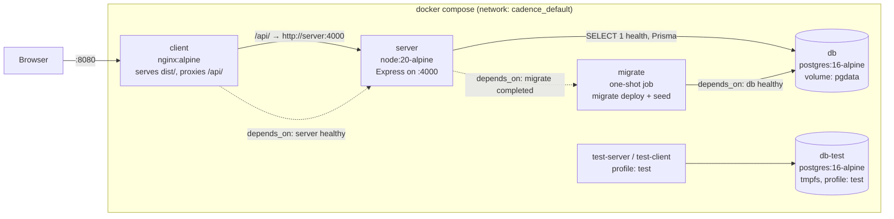
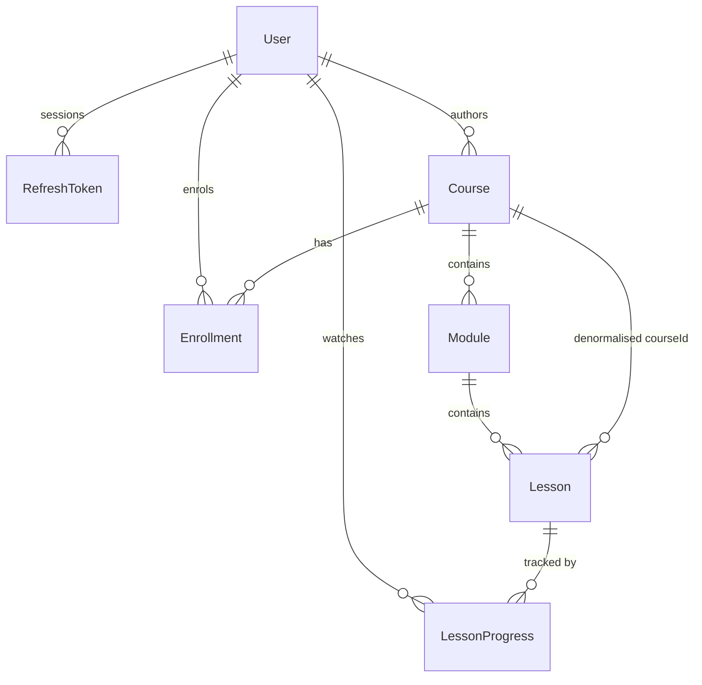

# Architecture

## The Compose stack



Start-up is ordered by conditions, not by sleeps: `db` must report healthy
(`pg_isready`), then `migrate` must exit 0, then `server` must report healthy
(`GET /api/v1/health`, which returns 200 only after a real `SELECT 1`), and
only then does `client` start.

**Why nginx serves the client.** The browser talks to one origin
(`localhost:8080`) and nginx proxies `/api/` to the API. That makes the auth
cookies first-party, removes CORS from the picture entirely, and means the
client ships no absolute API host. The server sets `trust proxy` so rate
limiting sees the real client IP and `Secure` cookies work behind TLS
termination. The CORS allow-list is kept for the non-Docker path, where Vite
serves the client on :5173.

**Dev vs prod-like.** `docker-compose.yml` is the prod-like stack: multi-stage
builds, production dependencies only, non-root `node` user, no secrets in
images. `docker-compose.dev.yml` overrides `server` and `client` to run from
the `builder` stage with `tsx watch` and `vite dev`, bind-mounting the source
with anonymous volumes over each `node_modules` so the container keeps its own
Linux-built dependencies.

## Layering

```
client/src
  app/         providers + route table
  pages/       one component per route; no fetching logic
  components/  ui/ primitives · common/ · courses/ · lessons/ · dashboard/ · admin/
  features/    api.ts (HTTP) + queries.ts (TanStack hooks) per domain
  lib/         api-client · query-client · query-keys · utils

server/src
  routes.ts    every route and its guards, in one readable file
  modules/<domain>/
    routes · controller (HTTP only) · service (business rules) · repository (Prisma only)
  middlewares/ authenticate · requireRole · validate · csrf · rateLimit · errorHandler
  lib/         prisma · jwt · password · cookies · errors · response · pagination · logger

shared/src     Zod schemas, enums, constants and formatters used by both sides
```

The rule is one-directional: **routes → controller → service → repository**.
Controllers never touch Prisma, services never touch `req` or `res`, and React
components never hold business rules — they call feature hooks. A service can
therefore be reasoned about (and tested) without an HTTP request, and the HTTP
layer has nothing in it worth testing beyond wiring.

## Shared Zod as the single source of truth

`shared/` holds one schema per payload. From each one comes:

1. the server's runtime validation (`validate({ body: courseInputSchema })`),
2. the TypeScript type (`z.infer`), used by both sides,
3. the OpenAPI document (`@asteasolutions/zod-to-openapi`),
4. the client form's resolver (`zodResolver(courseInputSchema)`).

So a rule like "a lesson's duration must be a positive integer" is written
once. The browser catches it before a request, the server catches it if the
browser is bypassed, the API docs describe it, and the generated type stops
code constructing an invalid object. There is no second description of the API
to drift.

One trap worth recording: `course.ts` imported `lesson.ts` for the lesson
summary while `lesson.ts` imported `course.ts` for a URL schema. At module
init the later import resolved to `undefined` and the package threw on first
use. Leaf schemas (`httpUrlSchema`, `mediaUrlSchema`) now live in `common.ts`,
which imports nothing from the domain.

## Authentication

- **Passwords**: bcrypt at cost 12. `bcryptjs` rather than the native `bcrypt`
  — same algorithm and cost, pure JavaScript, which keeps node-gyp, Python and
  a C toolchain out of the Alpine runtime image. The trade-off is a slower hash
  (~2.5x), and hashing happens only on register, login and password change.
- **Access token**: JWT, 15 minutes, in an `httpOnly` cookie.
- **Refresh token**: JWT, 7 days, in an `httpOnly` cookie **path-scoped to
  `/api/v1/auth`** so it is not sent on every API call. Stored as a SHA-256
  hash: a database leak hands out no sessions. bcrypt would be pointless here —
  the token is already 200+ bits of signed entropy, so there is nothing to
  brute-force.
- **Rotation and theft detection**: every refresh revokes the old token and
  issues a new one in the same transaction, tagged with a `familyId`.
  Presenting an already-revoked token means the chain leaked, so the entire
  family is revoked — signing out both the attacker and the real user, who
  then logs in again.
- **CSRF**: a readable `csrf_token` cookie must be echoed in `X-CSRF-Token` on
  every mutating request (double-submit). `SameSite=Lax` already blocks a
  plain cross-site form POST, but it says nothing about a same-site subdomain,
  so both are used. The auth endpoints are exempt: there is no session yet and
  they are what mint the token.
- **Why cookies rather than localStorage**: a token in localStorage is readable
  by any script that gets injected, and every XSS becomes account takeover.
  httpOnly cookies cannot be read by script at all; the cost is needing CSRF
  protection, which is a smaller and better-understood problem.
- **Deactivation takes effect immediately**: `authenticate` loads the user row
  on every request rather than trusting the token's claims, and deactivating a
  learner also revokes their refresh tokens.

## Authorization

Identity comes only from `req.user`, which `authenticate` sets from the
cookie. No handler reads a user id from the body, params or query — which is
what structurally rules out IDOR, rather than relying on remembering a check.
Progress and enrollment queries are always scoped by `userId = req.user.id`,
and the suite asserts that learner B cannot read or write learner A's
progress.

Admin routes sit behind one guard chain (`authenticate, csrfProtection,
requireRole('ADMIN')`) applied to the whole `/admin` router, so a new admin
endpoint cannot be added without inheriting it. The client's route guards are
a navigation convenience only; every test for an admin route is written
against the API, not the UI.

Content visibility is decided in one place:

| Course status | Anonymous / learner | Enrolled learner | Admin |
|---|---|---|---|
| `DRAFT` | **404** (not 403 — a 403 would confirm it exists) | 404 | full |
| `PUBLISHED` | catalog + preview lessons | full | full |
| `ARCHIVED` | 404, gone from the catalog | full, keeps access | full |

## Data model



UUID primary keys generated by the database (`gen_random_uuid()`), stored as
`@db.Uuid` so Postgres keeps 16 bytes rather than a 36-character string.

Constraints that matter:

- `users.email` unique, always written lowercased.
- `refresh_tokens.tokenHash` unique; indexed by `userId`, `familyId`, `expiresAt`.
- `@@unique([courseId, order])` on modules and `@@unique([moduleId, order])` on
  lessons, so two items cannot occupy one position.
- `@@unique([userId, courseId])` on enrollments — this is what makes enrolling
  idempotent at the database level, not just in the service.
- `@@unique([userId, lessonId])` on progress, which makes concurrent heartbeats
  from two tabs safe as upserts.
- `Course.createdById` is `onDelete: Restrict` — deleting an author must not
  silently delete the catalog. `Enrollment.courseId` likewise, so a course with
  learners cannot be deleted (the API answers 409 and says to archive).
- A raw-SQL migration adds CHECK constraints: lesson duration > 0, progress
  seconds ≥ 0, completion percentage within 0–100, and `completedAt` present
  exactly when `isCompleted` is true. Zod already rejects these at the
  boundary; the constraint is what holds for a direct SQL write or a future
  import script.

**Derived, never stored**: a course's `lessonCount` and `estimatedDuration`,
and every progress percentage. They are computed from the lessons on read, so
they cannot drift from the rows they summarise. The cost is a `groupBy` per
list request; the benefit is that no code path can leave a stale total behind.
`Lesson.courseId` is the one deliberate denormalisation — it makes enrollment
checks and course-wide counts a single index hit, and only `LessonService`
writes it, always from the module's own `courseId`.

## Progress and completion

The rules live in `progress.calculator.ts` as pure functions — no Prisma, no
clock, no randomness — so each is unit-tested directly:

- The reported position is clamped to `[0, duration]`. Non-finite input
  collapses to 0 rather than to the end: nonsense must never earn credit.
- `lastPositionSeconds` takes the newest value (seeking backwards is a
  legitimate place to resume from).
- `maxWatchedSeconds` never decreases, so rewatching cannot remove credit.
- A lesson completes when `maxWatchedSeconds ≥ 0.9 × duration`, or when
  `POST /complete` arrives within 2 seconds of the end (what the video's
  `ended` event reports). Opening a lesson never completes it.
- Completion is **sticky and idempotent**: once complete it stays complete,
  replays keep updating the position but never reset `completedAt`, and a
  duplicate completion returns the existing record.
- An unearned completion is a 422. The threshold check uses the **stored**
  `maxWatchedSeconds`, not the position in the request, so a client cannot
  skip to 97% and claim completion in one call.
- Course progress is completed lessons ÷ total lessons, computed server-side.
  A course with no lessons is 0%, not 100%.

Each write happens in a `$transaction` together with the enrollment roll-up
(completed count, `lastLessonId`, `lastAccessedAt`, and COMPLETED status with
`completedAt`), so the lesson row and the course summary can never disagree.

**Client side**, `useLessonProgressTracker` is deliberately not a mutation per
tick: a 20-minute lesson would otherwise fire hundreds of writes. It keeps the
position in a ref (so `timeupdate` causes no re-render), saves at most once
every 10 seconds and only when the position moved more than 2 seconds, and
flushes immediately on pause, seek, tab-hide and unmount. The unload flush uses
`fetch(..., { keepalive: true })` rather than `navigator.sendBeacon`, because
sendBeacon cannot set the `X-CSRF-Token` header the API requires.

**Known limitation**: the server trusts the position the client reports. A
scripted request could claim progress without watching. Closing that needs
signed segmented delivery and server-side verification of what was actually
fetched.

## Dashboards

Every figure comes from a SQL aggregate — `COUNT`, `SUM`, `GROUP BY`,
`FILTER` — never from fetching rows and counting them in Node, and nothing is
hardcoded. Where Prisma's `groupBy` cannot express the join (completed lessons
per course for one learner needs `lesson_progress` joined to `lessons`), the
repository uses a parameterised `$queryRaw`.

The activity feed is a `UNION ALL` over the four things that can happen
(enrolled, lesson started, lesson completed, course completed), ordered and
paged in SQL. There is no `activity` table: the feed is a projection of facts
already recorded on `enrollments` and `lesson_progress`. A write-side event log
would be the right move for a real audit trail — it would also record what
happened rather than what is currently true — but inventing one here would
create a second source of truth for the same facts.

## TanStack Query strategy

- **Keys** come from one factory (`lib/query-keys.ts`). Inline array keys are
  banned: they drift, and a typo silently creates a second cache entry.
  `invalidateQueries({ queryKey: qk.courses.all })` provably covers every
  course query.
- **Retries** skip client errors. Retrying a 403 or 422 only delays the error
  the user needs to see; 5xx and network failures are retried twice.
- **Mutation errors** surface as a toast from one central `MutationCache`
  handler, so no component can forget to report a failure. Forms opt out with
  `meta: { silent: true }` and render field-level errors instead, mapping the
  server's `errors` object back onto the inputs with `setError`.
- **Invalidation map**: enrolling invalidates courses, enrollments and the
  learner dashboard; completing a lesson also invalidates the course detail and
  the activity feed; admin content mutations invalidate both `qk.admin.*` and
  `qk.courses.*`, because publishing changes the admin table *and* the learner
  catalog.
- **Optimistic updates** on enrol: the panel flips immediately, `onError`
  restores the snapshot, `onSettled` refetches so authoritative numbers replace
  the optimistic guess.
- Server state lives only in the query cache. React context holds auth and
  theme and nothing else, and **nothing** about auth or progress is kept in
  localStorage.

## How the design artifacts became the UI

`docs/design-notes.md` is the full record. In short: the artifacts are vector
PDFs, so the tokens were read out of them rather than sampled from pixels —
`/BaseFont` entries gave the fonts, inflated content streams gave the exact
fill colours and geometry, and `pdfjs` gave every string with its position and
size. Page 2 of the desktop artifact is an explicit token sheet, so the colour
and type values in `globals.css` are quoted from the design rather than
guessed.

Those tokens are CSS variables; `tailwind.config.ts` maps every colour, radius,
shadow and type step onto them, and the Radix-based primitives in
`components/ui/` consume the Tailwind theme. So the whole UI re-themes from one
file, and a primitive cannot drift from the system by hardcoding a colour.

Fonts are self-hosted: `scripts/vendor-fonts.mjs` copies the variable `.woff2`
files out of `@fontsource` into `client/src/assets/fonts/` with their OFL
licences, `fonts.css` declares them with `font-display: swap` and a latin
`unicode-range`, and Vite fingerprints them into `dist/assets` where nginx
serves them `immutable` for a year. `grep -r "fonts.googleapis" client/`
returns nothing.

## Decisions and trade-offs

**Vite over Next.js.** This is an SPA talking to a separate API; there is no
SSR requirement, no server components and no SEO need behind a login. Next.js
would add a second server to run and reason about. The cost is no server-side
rendering, so first paint waits on the JS bundle — mitigated by code-splitting
the admin area (which owns the charting library) so the learner bundle is
125 kB gzipped.

**PostgreSQL, never SQLite.** The schema leans on real Postgres: `@db.Uuid`,
partial/composite indexes, `COUNT(...) FILTER (WHERE ...)`, `ANY($1::uuid[])`,
CHECK constraints, and transactional upserts. Testing against SQLite would
test a different database from the one that runs in production, which is the
one failure mode integration tests exist to catch.

**Tests against a real database, never a mocked Prisma.** A mock would assert
that the code calls the functions the author expected, which is exactly the
assumption most likely to be wrong. The suite uses a disposable Postgres on
tmpfs and truncates between files; the whole thing runs in about 45 seconds.

**Radix primitives, hand-assembled, rather than the shadcn CLI.** The result is
the same owned code in `components/ui/`, but generating it needs an
interactive CLI and network access at build time. Writing the primitives
directly keeps the repository self-contained and let each one be themed to the
artifact's tokens as it was written.

**Object literals rather than classes** for controllers, services,
repositories and the api client. Nothing in this codebase needs instance
state, and a module object is simpler to test and to tree-shake. The
consequence is that `@typescript-eslint/unbound-method` reports only false
positives, so it is turned off with that reasoning recorded in the config.

**No `activity` table** — see Dashboards above.

**Role changes are out of band.** An admin can activate and deactivate a
learner and nothing else: there is no API that grants ADMIN, so privilege
escalation is not on the attack surface. Promoting someone is a seed or a
deliberate database change.

**Lesson "locked" is a display hint.** The server independently refuses to
serve a gated lesson's video URL or record its progress, so a client that
ignores the hint gains nothing.

## Future work

- Signed, expiring video URLs behind a CDN; HLS with per-segment tokens, which
  is also what would let the server verify watch time instead of trusting it.
- An append-only event log, for a real audit trail and for funnel analytics
  (the artifact's "where learners stop" chart needs this).
- File uploads for thumbnails and video, with a storage layer.
- A real mail transport (Mailtrap SMTP) behind `lib/mailer.ts`, which today
  logs the message rather than sending it; and email verification, which is
  not implemented at all.
- Redis for rate limiting and refresh-token revocation, so more than one API
  replica behaves correctly.
- CI running typecheck, lint and both suites on every push, plus a Playwright
  happy path against the Compose stack.
- Internationalisation; the copy is currently inline English.
- A visual regression pass once the design artifacts can be rasterised in the
  build environment.

---

# The instructor feature

Three roles — LEARNER, INSTRUCTOR, ADMIN — where **roles are additive**:
becoming an instructor adds capabilities and removes none, and suspension
removes only the teaching ones.

## The permission model

With two roles, `role === 'ADMIN'` was workable. With three it is a bug
generator: an instructor *is* also a learner, so every `role === 'LEARNER'`
check would quietly withdraw a learner feature the moment someone was
approved. So the grants live in one map, `shared/src/permissions.ts`, read
by both sides:

```
LEARNING      learn · course:enroll · progress:write · dashboard:learner
LEARNER     = LEARNING + instructor:apply
INSTRUCTOR  = LEARNING + instructor:dashboard · course:create
                       · course:manage-own · lesson:manage-own
                       · media:upload · analytics:own-courses
ADMIN       = INSTRUCTOR + course:manage-any · lesson:manage-any
                         · analytics:any-course · analytics:platform
                         · application:review · instructor:manage · user:manage
```

`can(principal, permission)` is the only way anything asks. The server uses
it in `requirePermission(...)`; the client uses the *same function* in
`PermissionRoute`, the navigation and the profile menu, so the UI and the
API cannot disagree about what someone may do.

**`instructor:apply` is the one grant that is not inherited.** An instructor
has nothing to apply for and an admin already holds every teaching
permission, so modelling it as learner-only makes the "Become an Instructor"
entry point disappear by itself rather than needing a role check beside each
place it is rendered. This matches the capability table in the brief.

**Suspension is not a demotion.** The role stays INSTRUCTOR and no course,
enrollment or progress row is touched; `can()` withholds the six teaching
permissions when `instructorStatus === 'SUSPENDED'` and nothing else. That
one rule is what makes "you can still learn" true rather than merely
promised in the UI copy.

`requireRole('ADMIN')` is kept for the `/admin/*` namespace. Admin is the
one case where the role genuinely *is* the boundary — "instructors are not
administrators" — and stating it as a role stops a future permission grant
accidentally opening the admin area.

## Permissions take effect on the next request

The brief asks for approval and suspension to bite immediately rather than
when a 15-minute access token expires. No token-version column was needed:
`authenticate` already re-read the user row on every request, so it now
reads the instructor profile's status in the same query. The decision is
therefore visible to the user's **very next request**, whatever their token
says.

Approval and suspension additionally revoke the user's refresh-token family.
That is belt and braces — the access check is live either way — but it stops
a refresh token captured before the decision being rotated into a session
carrying the new capability.

On the client, `me` is re-read on three triggers:

1. **window focus** — the common case, when they read the notification in
   another tab and come back;
2. **a rising unread count**, because the bell is already polling every 60 s
   and a new notification may be the approval itself;
3. **a 401 or 403 from an instructor endpoint**, which means the server
   disagrees with what the UI believes; the api-client reports it and the
   app shell invalidates `qk.auth.me()`.

## Ownership

`Course.createdById` is reused as the owner. No rename and no data
migration: every existing row already carried the right value, and renaming
would have touched the catalog, dashboard and admin queries for no
behavioural gain. Services refer to it as `ownerId` in their signatures.

Ownership is enforced **in the service layer**, through `lib/ownership.ts`,
not only in route middleware — middleware cannot know about a particular
course. Every instructor-scoped read and write funnels through
`assertOwnsCourse` or `courseOwnerScope`, so the rule is stated once.

**Another instructor's course answers 404, never 403.** A 403 would confirm
the course exists, which leaks the catalogue of unpublished work across
accounts; a 404 makes someone else's draft indistinguishable from a course
that was never created. The same applies to modules, lessons, analytics,
learners and uploads.

Ownership is never taken from the request. `CourseInput` has no `ownerId`,
`instructorId`, `createdById` or `status` field at all, so the schema is the
mass-assignment defence rather than a filter applied afterwards that someone
can forget. Tests send all four anyway and assert they are ignored.

## Instructors as learners

An instructor **cannot enroll in their own course** (422, pointing at
Preview). Not a formality: their enrollment would appear in their own
learner counts, drag their own completion rate around, and show up in the
enrolled-learners table as if they were a student. The analytics queries
additionally exclude the owner and any admin, written into each query rather
than filtered afterwards.

Preview is the alternative, and it creates nothing: `resolveAccess` returns
`isTracked: false` for a course's owner, so the player writes no progress
row and no enrollment. The preview page reuses `getDetail` rather than
assembling a parallel payload, which is what stops it drifting from the
learner view.

## When a course's lessons change

Course progress is derived (completed ÷ total) and never stored, which stops
it drifting — but it also means the *enrollment* rows, which do store a
status and a completion date, go stale the moment the denominator moves.
`lessons.recalculate.ts` handles both directions inside the same transaction
as the change:

- **Deleting a lesson** cascades its progress rows away, so a learner who
  had 3 of 4 may now have 3 of 3; their enrollment is promoted to COMPLETED.
- **Adding a lesson** reopens enrollments that were COMPLETED, notifies
  those learners, and records a `LESSONS_ADDED` course event.

Reopening needed somewhere to keep the history. `completedAt` could not hold
it — the dashboards and the activity feed read that column as "are they done
*now*?", so leaving it set would count a reopened learner as finished. A
second migration therefore adds **`Enrollment.firstCompletedAt`**: "did they
ever finish?", backfilled from existing completions. Without it, adding a
lesson would quietly erase the fact that someone had completed the course.

One grouped query, not one per learner: a lesson deletion on a course with
hundreds of learners must not become hundreds of round trips.

## Applications

An append-only audit trail, not an overwritten field.
`InstructorApplicationEvent` records actor, action, from-status → to-status,
reason and timestamp for every decision, and internal notes live there too.
A rejected applicant reapplies with a **new** application; the old one is
kept as history.

Three properties are enforced rather than assumed:

- **At most one PENDING application per user**, by a partial unique index
  written as raw SQL (`WHERE status = 'PENDING'`) because Prisma cannot
  express a `WHERE` on an index — *and* by a service check. The service
  check gives the good message; the index catches the race it cannot. Two
  simultaneous submissions produce one 201 and one 409.
- **Decisions are safe under concurrency.** Every transition is
  `updateMany ... WHERE status = 'PENDING'` and checks the affected-row
  count, so two admins deciding at the same moment yield one success and one
  409 — never two decisions, never a lost one.
- **Approval is one transaction**: application → APPROVED, role →
  INSTRUCTOR, profile created, event recorded, notification written, refresh
  family revoked. A half-approved user — role changed, no profile — is a
  state the permission map cannot describe, so it must not be reachable.

An admin cannot decide their own application (403). Rejections and
suspensions require a reason, enforced in Zod, in the service, and by a
CHECK constraint so no other write path can record a reasonless one.

## Analytics: the metric definitions

Defined once in `analytics.service.ts` and used by the stat cards, all four
charts, the learners table and its filters alike. Each screen computing its
own is how a dashboard ends up showing two different "completion rates" for
one course with nobody able to say which is right.

| Metric | Definition |
|---|---|
| **Enrolled** | Enrollments on the course that are not CANCELLED, **excluding the owner and any admin** |
| **Active learner** | Any progress or enrollment activity in the last `ANALYTICS_ACTIVE_DAYS` (default 14) |
| **Completed learner** | Enrollment status COMPLETED |
| **Completion rate** | Completed learners ÷ enrolled learners (0 % when nobody is enrolled, not a division by zero) |
| **Average progress** | Mean of each learner's course progress, which is itself completed ÷ total lessons — the same figure the learner sees |

Every one is a SQL aggregate. Nothing loops over learner rows in JavaScript,
and the learners table searches, filters, sorts and pages in the database —
otherwise showing ten of a course's learners would mean fetching all of
them. Time series are grouped by ISO week in UTC (`date_trunc('week', …)`,
Monday-based), and the charts say which timezone they used.

The aggregates are tested against a fixture whose expected numbers are
worked out by hand in a table in the test file, so a wrong SQL change shows
up as a wrong number rather than a different-but-plausible one.

## Privacy

An instructor sees a learner's display name, email and progress **in that
course**. Not their other courses, not their role, not their account state,
not when they joined. The `select` clauses are narrow on purpose — the shape
is the enforcement, not a filter applied later that someone can forget — and
a test asserts the exact key set of a learner row and that a learner's other
courses never appear in the response.

A learner not enrolled in the course answers 404, so the endpoint cannot be
used to confirm that an arbitrary user id exists.

The public catalog exposes `instructor: { displayName, title, photoUrl }`
and nothing else, built by a dedicated projection from the profile row so
careless `select` widening upstream cannot leak an email or an account
state.

## Storage and uploads

One `StorageProvider` seam, two drivers:

- **local** writes to a Docker volume and is the **default**, so a reviewer
  gets working uploads from `docker compose up` with no cloud account;
- **s3** talks to the MinIO service in Compose, and to S3 or R2 in
  production. The browser PUTs straight to storage there, so a 2 GB video
  never passes through the API process. MinIO is behind the `storage`
  Compose profile, so the default `up` neither starts nor pulls it — a
  machine with a restricted registry should not fail its whole stack over
  a container the default configuration never uses.

Nothing above the seam knows which is configured. The tests run against the
local driver writing real files to a temp directory, so none of the storage
behaviour is mocked.

**The bytes are checked twice.** Before a target is issued: ownership of the
course, the MIME allow-list, the size ceiling. After the bytes land: the
*real* size, and the real type read from the file's **magic bytes**. The
declared Content-Type, the filename and the presign request are all
attacker-controlled and none of them is evidence — a file served back as a
type it does not have is how an "image" ends up parsed as HTML on our own
origin. An asset only becomes READY after that check, and the publish
checklist only accepts READY assets, so nothing a learner can reach has
skipped it.

**Nothing binary is stored in Postgres** — only the key and the metadata.

**Durations** come from ffprobe where the binary exists, and otherwise from
the browser's `loadedmetadata` value, sanity-checked and *dropped* rather
than clamped if implausible. This is not cosmetic: completion is
`maxWatched ≥ 0.9 × duration`, so a client claiming one second would make a
lesson trivially completable. Manual entry is allowed only for external
URLs, where there is genuinely nothing to measure.

**Playback**: lesson videos are never public. The lesson endpoint mints a
short-lived signed URL (S3) or points at the API's own streaming endpoint
(local), and only after the existing access check. That endpoint reuses
`resolveAccess` rather than restating the rule, so the stream and the player
page cannot disagree about who may watch. HTTP Range is supported so seeking
works.

### Resumable uploads

Above `UPLOAD_MULTIPART_THRESHOLD_MB` (16 by default) the file is sent in
parts. The win is simple: a dropped connection costs one part rather than
the whole transfer, and on a 2 GB video that is the difference between a
usable feature and an unusable one.

Both drivers implement it — S3 through its native multipart API, the local
driver by staging part files under `.multipart/<uploadId>/` and
concatenating them on completion. The local staging lives beside the
storage root rather than in the OS temp directory precisely so a part
written before a container restart is still there afterwards.

**The provider is the source of truth for which parts have landed**, not
our database. With S3 the browser PUTs straight to the bucket and the API
never sees the parts, so `ListParts` is the only answer that cannot be
stale — and it means there is no parts table to drift out of step with
storage.

Resuming works in two layers:

- **Within an attempt**: a part that fails is retried with exponential
  backoff, up to four times, without disturbing the parts around it. Three
  parts travel at once; an unbounded fan-out of 256 requests would be
  throttled by the browser anyway and would make the progress bar
  meaningless.
- **Across attempts**: the client sends a fingerprint of the chosen file
  (`name|size|lastModified`) with the presign request. If the server finds
  an unfinished upload of the same file it hands that one back along with
  the parts already stored, and only the rest are sent. The fingerprint is
  what stops two *different* videos of the same size being stitched
  together from each other's parts — a test covers exactly that.

Completion refuses a gap. A truncated file would still pass the magic-byte
check, because the header is in part 1, and would then fail to play; so
every part must be present before the object is assembled.

Cancelling aborts the multipart upload as well as deleting the row.
That matters beyond tidiness: S3 charges for orphaned parts indefinitely
and they do not appear in a normal bucket listing, so an upload abandoned
without an abort is a bill nobody can see. The orphan-cleanup job aborts
them too.

Presign requests are rate-limited **per user, not per IP**, so several
instructors behind one office NAT do not throttle each other.

## Notifications

In-app only. Every notification is created in the **same transaction** as
the event that causes it, so a user is never told about an approval that was
rolled back. `NotificationChannel` is declared as the seam an email or push
channel would plug into — declared rather than merely described, so the
shape is checked by the compiler.

The bell polls every 60 s and on window focus. Polling rather than
websockets: one small request a minute is far less machinery for a feature
whose latency requirement is "within a minute or so".

## Course content versioning

**The Course row is the instructor's draft; a `CourseVersion` is what
learners see.**

Before this, correcting a typo and restructuring a curriculum were the
same operation, and both landed on learners mid-lesson. Now an instructor
can work on the next revision of a live course and decide when it ships.

### The snapshot references lessons, it does not copy them

`CourseVersion` holds the course's presentation — title, descriptions,
category, difficulty, thumbnail, objectives, prerequisites, audience —
frozen at publish time. `CourseVersionLesson` holds how each lesson was
presented, and points at the **live lesson row by id**.

That indirection is the whole design. `LessonProgress` is keyed by
`lessonId`, so duplicating lesson rows per version would orphan every
learner's history on each publish. Instead a lesson is one row with one
identity, and a version records how it was described — which means an
instructor can rename a lesson after a hundred people have completed it
and all hundred completions survive.

### What a learner sees

| Read | Source |
|---|---|
| Catalog list, search and category filter | the live version |
| Course detail, its module tree and lesson list | the live version |
| A single lesson, including whether it is a free preview | the live version |
| Previous / next navigation in the player | the live version |
| Everything an instructor or admin sees | the draft |

Searching the draft would have been the easy mistake: a learner typing
the title they can see would find nothing the moment its author started
editing, and a half-written draft title would become searchable before
anyone published it.

An unpublished lesson is a **404, not a 403**, even with its id in hand.
Without that, versioning would be cosmetic — the course page would hide
the lesson while a bookmarked URL still played it.

### What is deliberately *not* deferred

**Deleting a lesson takes effect at once.** It also deletes every
learner's progress on that lesson, and there is no honest way to defer
half of that; the snapshot row cascades with it. A published curriculum
getting shorter is better than one listing a lesson nobody can play. The
pending-changes list therefore never reports a removal — the code that
would detect one is kept as a guard, and documented as normally empty.

### Pending changes

`draftState` returns a list of what a learner would notice, not a
boolean, because the instructor's question is never "is something
different?" but "what changes if I publish?". A reorder is reported once
rather than per lesson: moving one lesson up is one change, not five.

The course cards use a cheaper proxy — `updatedAt` later than the live
version's `publishedAt` — because running a field-by-field diff per card
to draw a badge would be wasteful. A false positive there costs a banner
that then lists no changes; it can never hide a real one.

### Migration

Every already-published course was snapshotted as version 1 at migration
time, with a guard that fails the migration if any published course is
left without one. Without that backfill, every published course would
have vanished from the catalogue the moment this deployed, taking its
enrolled learners' access with it.

## Decisions and trade-offs — instructor feature

| Decision | Alternative | Why |
|---|---|---|
| Reuse `Course.createdById` as the owner | add an `instructorId` column | Every existing row already carried the right value. A rename would have touched the catalog, dashboard and admin queries for no behavioural gain. |
| 404, not 403, for another instructor's resource | 403 | A 403 confirms the resource exists, leaking the catalogue of unpublished work. |
| No `tokenVersion` column | bump a version on every role change | `authenticate` already re-read the user row per request; adding the profile status to that read gives the same guarantee with no new column to keep in step. |
| `instructor:apply` not inherited | make it additive like everything else | Matches the brief's capability table, and makes the CTA disappear without a role check at each render site. |
| `Enrollment.firstCompletedAt` as a new column | keep `completedAt` set while reopening | `completedAt IS NOT NULL` is read as "done now" by the dashboards and the activity feed; keeping it set would count a reopened learner as finished. |
| A version snapshots presentation and *references* lessons | copy the lesson rows per version | Progress is keyed by `lessonId`. Copying lesson rows would orphan every learner's history on each publish. |
| Deleting a lesson is immediate, not deferred to publish | defer deletion like every other change | Deletion also removes learners' progress, which cannot honestly be deferred. A shorter published curriculum beats one listing an unplayable lesson. |
| Course cards use `updatedAt` vs `publishedAt` as the "has changes" proxy | run the full diff per card | A field-by-field diff per card to draw a badge is wasteful; a false positive costs an empty banner, never a missed change. |
| A suspended instructor's courses are **hidden from the catalog**, and enrolled learners keep access | leave them visible | The brief's recommendation. It stops a suspended instructor gaining new learners without punishing the ones already there. |
| Local disk is the **default** storage driver | require S3/MinIO | A reviewer must get working uploads from one command. S3 is one env var away. |
| Charts as CSS rather than a charting library | Recharts | For four charts of this shape it is less code, renders instantly, and the numbers stay real text a screen reader and find-in-page can read. Each also has a table view. |
| Resume keyed on a file fingerprint, not a cookie or a server session | a per-tab upload id | A browser cannot re-read a `File` across a reload, so resuming after one means the user re-picks the file. The fingerprint is what proves it is the same file. |
| The provider lists the uploaded parts, rather than a `MediaUploadPart` table | track parts in Postgres | With S3 the API never sees the parts, so a table could only ever be a guess that drifts from the bucket. |
| Reordering offers drag **and** explicit arrow buttons | drag plus a keyboard sensor | A keyboard sensor still requires discovering that a handle is draggable. Two visible arrows require no discovery and are what a screen-reader user finds. |
| Notification polling at 60 s | websockets / SSE | Far less machinery for a one-minute latency requirement. |
| The dialog's lesson form allows saving without a video | require one | The artifact says so explicitly ("You can save now and add the video later"); the publish checklist is what stops such a lesson reaching a learner. |

## Deviations from the base skill, for this feature

Recorded as the brief asks:

| Deviation | Reason |
|---|---|
| `requirePermission` is the guard for new routes, not `requireRole` | The brief requires a permission map; `requireRole` is kept only for `/admin/*`. |
| The instructor workspace has its own layout rather than extending the learner shell | The artifacts give teaching its own chrome so an instructor always knows which workspace they are in. |
| Two extra client dependencies: `@dnd-kit/*` and `@aws-sdk/client-s3` (server) | Drag-and-drop reordering and S3-compatible storage are both explicitly required and neither is reasonable to hand-roll. |
