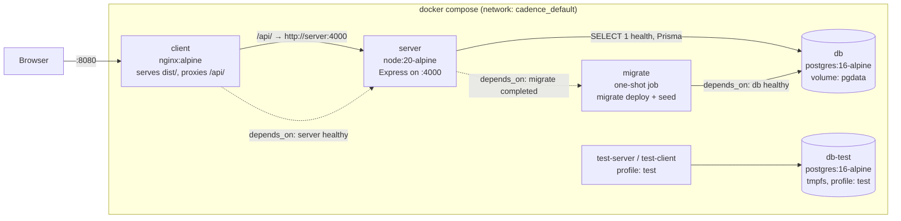
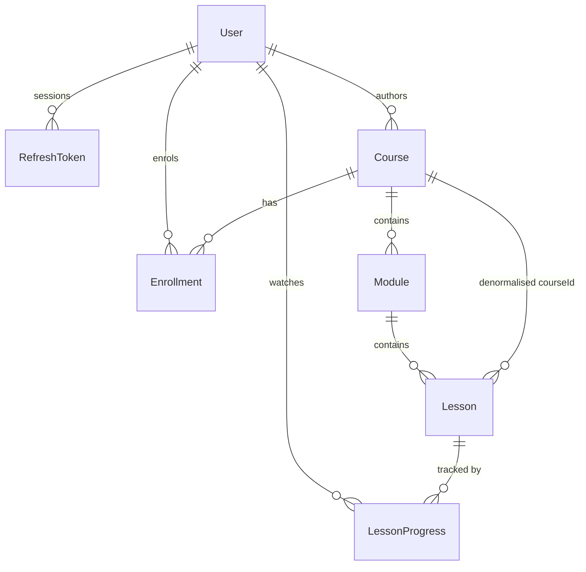

# Architecture

## The Compose stack



Start-up is ordered by conditions, not by sleeps: `db` must report healthy
(`pg_isready`), then `migrate` must exit 0, then `server` must report healthy
(`GET /api/v1/health`, which returns 200 only after a real `SELECT 1`), and
only then does `client` start.

**Why nginx serves the client.** The browser talks to one origin
(`localhost:8080`) and nginx proxies `/api/` to the API. That makes the auth
cookies first-party, removes CORS from the picture entirely, and means the
client ships no absolute API host. The server sets `trust proxy` so rate
limiting sees the real client IP and `Secure` cookies work behind TLS
termination. The CORS allow-list is kept for the non-Docker path, where Vite
serves the client on :5173.

**Dev vs prod-like.** `docker-compose.yml` is the prod-like stack: multi-stage
builds, production dependencies only, non-root `node` user, no secrets in
images. `docker-compose.dev.yml` overrides `server` and `client` to run from
the `builder` stage with `tsx watch` and `vite dev`, bind-mounting the source
with anonymous volumes over each `node_modules` so the container keeps its own
Linux-built dependencies.

## Layering

```
client/src
  app/         providers + route table
  pages/       one component per route; no fetching logic
  components/  ui/ primitives · common/ · courses/ · lessons/ · dashboard/ · admin/
  features/    api.ts (HTTP) + queries.ts (TanStack hooks) per domain
  lib/         api-client · query-client · query-keys · utils

server/src
  routes.ts    every route and its guards, in one readable file
  modules/<domain>/
    routes · controller (HTTP only) · service (business rules) · repository (Prisma only)
  middlewares/ authenticate · requireRole · validate · csrf · rateLimit · errorHandler
  lib/         prisma · jwt · password · cookies · errors · response · pagination · logger

shared/src     Zod schemas, enums, constants and formatters used by both sides
```

The rule is one-directional: **routes → controller → service → repository**.
Controllers never touch Prisma, services never touch `req` or `res`, and React
components never hold business rules — they call feature hooks. A service can
therefore be reasoned about (and tested) without an HTTP request, and the HTTP
layer has nothing in it worth testing beyond wiring.

## Shared Zod as the single source of truth

`shared/` holds one schema per payload. From each one comes:

1. the server's runtime validation (`validate({ body: courseInputSchema })`),
2. the TypeScript type (`z.infer`), used by both sides,
3. the OpenAPI document (`@asteasolutions/zod-to-openapi`),
4. the client form's resolver (`zodResolver(courseInputSchema)`).

So a rule like "a lesson's duration must be a positive integer" is written
once. The browser catches it before a request, the server catches it if the
browser is bypassed, the API docs describe it, and the generated type stops
code constructing an invalid object. There is no second description of the API
to drift.

One trap worth recording: `course.ts` imported `lesson.ts` for the lesson
summary while `lesson.ts` imported `course.ts` for a URL schema. At module
init the later import resolved to `undefined` and the package threw on first
use. Leaf schemas (`httpUrlSchema`, `mediaUrlSchema`) now live in `common.ts`,
which imports nothing from the domain.

## Authentication

- **Passwords**: bcrypt at cost 12. `bcryptjs` rather than the native `bcrypt`
  — same algorithm and cost, pure JavaScript, which keeps node-gyp, Python and
  a C toolchain out of the Alpine runtime image. The trade-off is a slower hash
  (~2.5x), and hashing happens only on register, login and password change.
- **Access token**: JWT, 15 minutes, in an `httpOnly` cookie.
- **Refresh token**: JWT, 7 days, in an `httpOnly` cookie **path-scoped to
  `/api/v1/auth`** so it is not sent on every API call. Stored as a SHA-256
  hash: a database leak hands out no sessions. bcrypt would be pointless here —
  the token is already 200+ bits of signed entropy, so there is nothing to
  brute-force.
- **Rotation and theft detection**: every refresh revokes the old token and
  issues a new one in the same transaction, tagged with a `familyId`.
  Presenting an already-revoked token means the chain leaked, so the entire
  family is revoked — signing out both the attacker and the real user, who
  then logs in again.
- **CSRF**: a readable `csrf_token` cookie must be echoed in `X-CSRF-Token` on
  every mutating request (double-submit). `SameSite=Lax` already blocks a
  plain cross-site form POST, but it says nothing about a same-site subdomain,
  so both are used. The auth endpoints are exempt: there is no session yet and
  they are what mint the token.
- **Why cookies rather than localStorage**: a token in localStorage is readable
  by any script that gets injected, and every XSS becomes account takeover.
  httpOnly cookies cannot be read by script at all; the cost is needing CSRF
  protection, which is a smaller and better-understood problem.
- **Deactivation takes effect immediately**: `authenticate` loads the user row
  on every request rather than trusting the token's claims, and deactivating a
  learner also revokes their refresh tokens.

## Authorization

Identity comes only from `req.user`, which `authenticate` sets from the
cookie. No handler reads a user id from the body, params or query — which is
what structurally rules out IDOR, rather than relying on remembering a check.
Progress and enrollment queries are always scoped by `userId = req.user.id`,
and the suite asserts that learner B cannot read or write learner A's
progress.

Admin routes sit behind one guard chain (`authenticate, csrfProtection,
requireRole('ADMIN')`) applied to the whole `/admin` router, so a new admin
endpoint cannot be added without inheriting it. The client's route guards are
a navigation convenience only; every test for an admin route is written
against the API, not the UI.

Content visibility is decided in one place:

| Course status | Anonymous / learner | Enrolled learner | Admin |
|---|---|---|---|
| `DRAFT` | **404** (not 403 — a 403 would confirm it exists) | 404 | full |
| `PUBLISHED` | catalog + preview lessons | full | full |
| `ARCHIVED` | 404, gone from the catalog | full, keeps access | full |

## Data model



UUID primary keys generated by the database (`gen_random_uuid()`), stored as
`@db.Uuid` so Postgres keeps 16 bytes rather than a 36-character string.

Constraints that matter:

- `users.email` unique, always written lowercased.
- `refresh_tokens.tokenHash` unique; indexed by `userId`, `familyId`, `expiresAt`.
- `@@unique([courseId, order])` on modules and `@@unique([moduleId, order])` on
  lessons, so two items cannot occupy one position.
- `@@unique([userId, courseId])` on enrollments — this is what makes enrolling
  idempotent at the database level, not just in the service.
- `@@unique([userId, lessonId])` on progress, which makes concurrent heartbeats
  from two tabs safe as upserts.
- `Course.createdById` is `onDelete: Restrict` — deleting an author must not
  silently delete the catalog. `Enrollment.courseId` likewise, so a course with
  learners cannot be deleted (the API answers 409 and says to archive).
- A raw-SQL migration adds CHECK constraints: lesson duration > 0, progress
  seconds ≥ 0, completion percentage within 0–100, and `completedAt` present
  exactly when `isCompleted` is true. Zod already rejects these at the
  boundary; the constraint is what holds for a direct SQL write or a future
  import script.

**Derived, never stored**: a course's `lessonCount` and `estimatedDuration`,
and every progress percentage. They are computed from the lessons on read, so
they cannot drift from the rows they summarise. The cost is a `groupBy` per
list request; the benefit is that no code path can leave a stale total behind.
`Lesson.courseId` is the one deliberate denormalisation — it makes enrollment
checks and course-wide counts a single index hit, and only `LessonService`
writes it, always from the module's own `courseId`.

## Progress and completion

The rules live in `progress.calculator.ts` as pure functions — no Prisma, no
clock, no randomness — so each is unit-tested directly:

- The reported position is clamped to `[0, duration]`. Non-finite input
  collapses to 0 rather than to the end: nonsense must never earn credit.
- `lastPositionSeconds` takes the newest value (seeking backwards is a
  legitimate place to resume from).
- `maxWatchedSeconds` never decreases, so rewatching cannot remove credit.
- A lesson completes when `maxWatchedSeconds ≥ 0.9 × duration`, or when
  `POST /complete` arrives within 2 seconds of the end (what the video's
  `ended` event reports). Opening a lesson never completes it.
- Completion is **sticky and idempotent**: once complete it stays complete,
  replays keep updating the position but never reset `completedAt`, and a
  duplicate completion returns the existing record.
- An unearned completion is a 422. The threshold check uses the **stored**
  `maxWatchedSeconds`, not the position in the request, so a client cannot
  skip to 97% and claim completion in one call.
- Course progress is completed lessons ÷ total lessons, computed server-side.
  A course with no lessons is 0%, not 100%.

Each write happens in a `$transaction` together with the enrollment roll-up
(completed count, `lastLessonId`, `lastAccessedAt`, and COMPLETED status with
`completedAt`), so the lesson row and the course summary can never disagree.

**Client side**, `useLessonProgressTracker` is deliberately not a mutation per
tick: a 20-minute lesson would otherwise fire hundreds of writes. It keeps the
position in a ref (so `timeupdate` causes no re-render), saves at most once
every 10 seconds and only when the position moved more than 2 seconds, and
flushes immediately on pause, seek, tab-hide and unmount. The unload flush uses
`fetch(..., { keepalive: true })` rather than `navigator.sendBeacon`, because
sendBeacon cannot set the `X-CSRF-Token` header the API requires.

**Known limitation**: the server trusts the position the client reports. A
scripted request could claim progress without watching. Closing that needs
signed segmented delivery and server-side verification of what was actually
fetched.

## Dashboards

Every figure comes from a SQL aggregate — `COUNT`, `SUM`, `GROUP BY`,
`FILTER` — never from fetching rows and counting them in Node, and nothing is
hardcoded. Where Prisma's `groupBy` cannot express the join (completed lessons
per course for one learner needs `lesson_progress` joined to `lessons`), the
repository uses a parameterised `$queryRaw`.

The activity feed is a `UNION ALL` over the four things that can happen
(enrolled, lesson started, lesson completed, course completed), ordered and
paged in SQL. There is no `activity` table: the feed is a projection of facts
already recorded on `enrollments` and `lesson_progress`. A write-side event log
would be the right move for a real audit trail — it would also record what
happened rather than what is currently true — but inventing one here would
create a second source of truth for the same facts.

## TanStack Query strategy

- **Keys** come from one factory (`lib/query-keys.ts`). Inline array keys are
  banned: they drift, and a typo silently creates a second cache entry.
  `invalidateQueries({ queryKey: qk.courses.all })` provably covers every
  course query.
- **Retries** skip client errors. Retrying a 403 or 422 only delays the error
  the user needs to see; 5xx and network failures are retried twice.
- **Mutation errors** surface as a toast from one central `MutationCache`
  handler, so no component can forget to report a failure. Forms opt out with
  `meta: { silent: true }` and render field-level errors instead, mapping the
  server's `errors` object back onto the inputs with `setError`.
- **Invalidation map**: enrolling invalidates courses, enrollments and the
  learner dashboard; completing a lesson also invalidates the course detail and
  the activity feed; admin content mutations invalidate both `qk.admin.*` and
  `qk.courses.*`, because publishing changes the admin table *and* the learner
  catalog.
- **Optimistic updates** on enrol: the panel flips immediately, `onError`
  restores the snapshot, `onSettled` refetches so authoritative numbers replace
  the optimistic guess.
- Server state lives only in the query cache. React context holds auth and
  theme and nothing else, and **nothing** about auth or progress is kept in
  localStorage.

## How the design artifacts became the UI

`docs/design-notes.md` is the full record. In short: the artifacts are vector
PDFs, so the tokens were read out of them rather than sampled from pixels —
`/BaseFont` entries gave the fonts, inflated content streams gave the exact
fill colours and geometry, and `pdfjs` gave every string with its position and
size. Page 2 of the desktop artifact is an explicit token sheet, so the colour
and type values in `globals.css` are quoted from the design rather than
guessed.

Those tokens are CSS variables; `tailwind.config.ts` maps every colour, radius,
shadow and type step onto them, and the Radix-based primitives in
`components/ui/` consume the Tailwind theme. So the whole UI re-themes from one
file, and a primitive cannot drift from the system by hardcoding a colour.

Fonts are self-hosted: `scripts/vendor-fonts.mjs` copies the variable `.woff2`
files out of `@fontsource` into `client/src/assets/fonts/` with their OFL
licences, `fonts.css` declares them with `font-display: swap` and a latin
`unicode-range`, and Vite fingerprints them into `dist/assets` where nginx
serves them `immutable` for a year. `grep -r "fonts.googleapis" client/`
returns nothing.

## Decisions and trade-offs

**Vite over Next.js.** This is an SPA talking to a separate API; there is no
SSR requirement, no server components and no SEO need behind a login. Next.js
would add a second server to run and reason about. The cost is no server-side
rendering, so first paint waits on the JS bundle — mitigated by code-splitting
the admin area (which owns the charting library) so the learner bundle is
125 kB gzipped.

**PostgreSQL, never SQLite.** The schema leans on real Postgres: `@db.Uuid`,
partial/composite indexes, `COUNT(...) FILTER (WHERE ...)`, `ANY($1::uuid[])`,
CHECK constraints, and transactional upserts. Testing against SQLite would
test a different database from the one that runs in production, which is the
one failure mode integration tests exist to catch.

**Tests against a real database, never a mocked Prisma.** A mock would assert
that the code calls the functions the author expected, which is exactly the
assumption most likely to be wrong. The suite uses a disposable Postgres on
tmpfs and truncates between files; the whole thing runs in about 45 seconds.

**Radix primitives, hand-assembled, rather than the shadcn CLI.** The result is
the same owned code in `components/ui/`, but generating it needs an
interactive CLI and network access at build time. Writing the primitives
directly keeps the repository self-contained and let each one be themed to the
artifact's tokens as it was written.

**Object literals rather than classes** for controllers, services,
repositories and the api client. Nothing in this codebase needs instance
state, and a module object is simpler to test and to tree-shake. The
consequence is that `@typescript-eslint/unbound-method` reports only false
positives, so it is turned off with that reasoning recorded in the config.

**No `activity` table** — see Dashboards above.

**Role changes are out of band.** An admin can activate and deactivate a
learner and nothing else: there is no API that grants ADMIN, so privilege
escalation is not on the attack surface. Promoting someone is a seed or a
deliberate database change.

**Lesson "locked" is a display hint.** The server independently refuses to
serve a gated lesson's video URL or record its progress, so a client that
ignores the hint gains nothing.

## Future work

- Signed, expiring video URLs behind a CDN; HLS with per-segment tokens, which
  is also what would let the server verify watch time instead of trusting it.
- An append-only event log, for a real audit trail and for funnel analytics
  (the artifact's "where learners stop" chart needs this).
- File uploads for thumbnails and video, with a storage layer.
- Email: verification, password reset.
- Redis for rate limiting and refresh-token revocation, so more than one API
  replica behaves correctly.
- CI running typecheck, lint and both suites on every push, plus a Playwright
  happy path against the Compose stack.
- Internationalisation; the copy is currently inline English.
- A visual regression pass once the design artifacts can be rasterised in the
  build environment.
